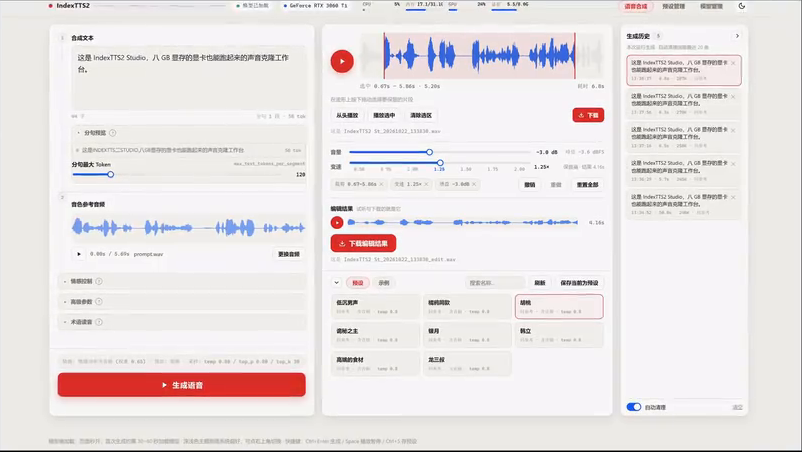
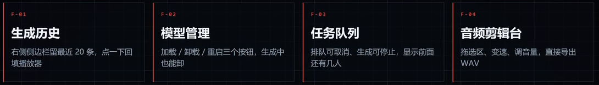
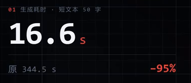

# IndexTTS2 WebUI

**原项目：[index-tts/index-tts](https://github.com/index-tts/index-tts)**  
**模型运行与使用体验优化：[lfandrh](https://github.com/lfandrh)**  
[优化版介绍视频](https://www.bilibili.com/video/BV1pVnp6sErL/)

基于 IndexTTS 2.0 的中文本地配音工具，支持声音克隆、情感控制和音频编辑。沿用官方模型权重，围绕生成速度、显存占用和操作体验进行优化。



## 相比原项目，改进了什么

对比基准为[官方 v2.0.0](https://github.com/index-tts/index-tts/tree/830f6f8f94a51fea23ab1d639027a86200075a4e)的默认界面与推理流程。声音克隆、情感控制、中文支持和基础进度反馈均为原项目已有能力；本版沿用官方权重，主要改进运行效率与日常操作。

### 运行与显存

| 对比项 | 官方原版 | 本版改进与作用 |
| --- | --- | --- |
| 主模型加载 | 启动网页服务时初始化模型。 | 首次合成时再加载，缩短打开界面前的等待，延后显存占用。 |
| Qwen 情感模型 | 随主模型一起初始化。 | 仅首次使用文本情感控制时加载，普通配音不必为它占用显存。 |
| 半精度控制 | 已支持主模型 FP16，但未提供 w2v、s2mel 的独立半精度开关。 | 为语义编码器和扩散模型增加半精度设置，以降低显存占用，并可按设备和音质需要切换。 |
| 加速配置 | 提供 DeepSpeed、torch.compile、GPT2 加速、自定义 CUDA 核等可选路径。 | 精简这些可选路径，集中使用本版的半精度方案，减少额外依赖和配置选择。 |

### 界面与配音流程



| 对比项 | 官方原版 | 本版改进与作用 |
| --- | --- | --- |
| 界面与进度 | Gradio 界面，已有中文及基础生成进度。 | 重做为合成、预设、模型管理三个页面；细化阶段进度，加入波形、深浅色主题和 CPU/GPU 状态。 |
| 队列与模型管理 | 通过 Gradio 队列生成，默认界面没有独立的模型加载、卸载和重载操作。 | 明确显示排队状态，支持取消排队、停止生成；可在页面加载、卸载或重载模型，方便释放显存。 |
| 预设与历史 | 提供示例选择和参数设置，没有独立的用户预设管理及生成历史面板。 | 保存、复制、重命名常用音色与参数；保留当前运行期间最近 20 条历史，方便回听。 |
| 音频剪辑 | 主要提供合成、播放和下载。 | 增加裁剪、音量调整、0.5–2 倍保音高变速、撤销重做和 WAV 导出，减少切换编辑软件。 |
| 读音与停顿 | 已有术语读音表；底层支持段间停顿，默认界面未开放停顿调节。 | 补充术语单条删除、清空及级联替换开关；页面直接调节 10–500 毫秒段间停顿。 |

### 本仓库后续补充

| 补充项 | 用途 |
| --- | --- |
| MCP 与 CLI | AI 助手或命令行可提交配音、查询进度、编辑和导出音频，与网页共用同一后台及模型。 |
| 中文路径修复 | 修复分词模型在 Windows 中文目录下的加载问题。 |
| 数据保护 | 加入预设覆盖保护、排队任务参考音频保护；预设及历史音频删除采用回收站处理。 |

## 性能参考

测试环境：RTX 3060 Ti 8 GB。



| 测试文本 | 视频中的原版 | 优化版 |
| --- | ---: | ---: |
| 50 字 | 344.5 秒 | 16.6 秒 |
| 100 字 | 186 秒 | 32 秒 |

数据来自上方介绍视频，并非本仓库对上述固定版本的独立复测；实际速度取决于设备与参数，半精度设置也可能影响音质。

## 快速开始

> 当前为源码发布准备版，快速开始参考 [indextts2-studio](https://github.com/lfandrh/indextts2-studio)。依赖锁文件和全新环境安装验证尚未完成，模型与依赖需按以下步骤准备。

**运行前提：** Windows 10/11、NVIDIA 显卡（建议 8 GB 及以上显存，驱动支持 CUDA 12.8），并安装 [uv](https://docs.astral.sh/uv/getting-started/installation/)。Python 3.11 由 uv 自动准备。首次安装需要联网，模型和运行环境单独下载，不随源码打包。

**1. 下载源码**

在本仓库点击 **Code → Download ZIP**，解压后进入包含 `pyproject.toml` 的文件夹，在该文件夹打开 PowerShell 7。以下命令均在此处执行。

**2. 安装依赖**

```powershell
uv sync --python 3.11 --extra server
```

**3. 下载模型（首次使用）**

从官方 ModelScope 仓库下载主模型，再准备语音编码器、声码器等辅助模型：

```powershell
uv run --extra server modelscope download --model IndexTeam/IndexTTS-2 --local_dir checkpoints
uv run --extra server python -c "from indextts.utils.model_download import ensure_models_available; ensure_models_available('checkpoints')"
```

主模型保存在 `checkpoints/`，辅助模型保存在 `checkpoints/hf_cache/`。已有完整模型可直接复用；也可从 [ModelScope](https://modelscope.cn/models/IndexTeam/IndexTTS-2) 或 [Hugging Face](https://huggingface.co/IndexTeam/IndexTTS-2) 手动下载主模型，保持目录结构完整。

**4. 启动并配音**

```powershell
uv run --extra server python server.py --port 7860
```

完成前 3 步后，也可双击项目根目录的 `run-app.cmd` 启动。

浏览器打开 [http://127.0.0.1:7860](http://127.0.0.1:7860)，上传 3–10 秒清晰的参考音频，输入文本，点击生成。完成后可直接下载，也可先裁剪、调音量或变速。首次生成会加载模型，耗时通常更长。

使用期间保留终端窗口；结束时按 `Ctrl+C` 停止服务。后续使用只需重复第 4 步。MCP/CLI 按需启用，见 [接入说明](indextts-mcp/README.md)。

## 许可

模型与上游代码遵循[《bilibili模型使用许可协议》](LICENSE)，中英文不一致时以[中文协议](LICENSE_ZH.txt)为准。使用前请阅读[TTS语音合成技术免责声明](DISCLAIMER)。第三方依赖遵循各自许可证。

发布或转发本项目及其衍生品时，须保留原始版权声明及上述许可协议，并要求下游用户遵守协议。

该衍生品对原模型所作的任何改动与原模型原始权利人无关，原始权利人对该衍生品不背书、不担保、不承担责任。
